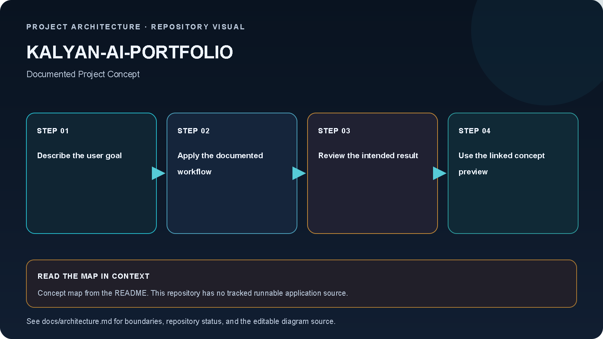

# kalyan-ai-portfolio — architecture and repository status

**Repository:** [https://github.com/kalyan870/kalyan-ai-portfolio](https://github.com/kalyan870/kalyan-ai-portfolio)

**Live link:** https://kalyan-ai-portfolio.netlify.app/

[Open the editable SVG](images/kalyan-ai-portfolio-architecture.svg)

## What this map represents

Concept map derived from the README; it is not an implemented runtime architecture.

## Verified repository facts

- This repository contains project documentation/showcase material only; no runnable application source was found in the tracked tree.
- Default branch: `main`.
- Main language reported by GitHub: `not reported`.
- Top-level tracked directories: none.
- GitHub Actions workflow present: `no`.
- Existing build/dependency manifests: none detected.

## Security and data boundaries

This documentation update does not add sign-in, a database, or file storage. Those belong only where the application has a verified account, durable relational-data, or persistent uploaded-file requirement. Review the application code and deployment settings before using private user data; this map is not a security audit.

## Run and test

Use the commands already documented in the [project README](../README.md). No setup or test command is invented here.
